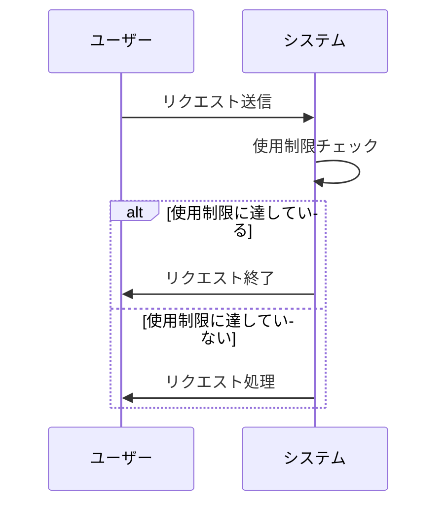

# Claude Code v2.1.301 アップデートまとめ

> 出典: https://code.claude.com/docs/en/changelog#2-1-301

## 💡 注目ポイント

### 1. リトライウォッチドッグの最大使用制限待機時間の追加

`CLAUDE_CODE_RETRY_WATCHDOG_MAX_USAGE_LIMIT_WAIT_MS` を追加し、無人リトライモード (`CLAUDE_CODE_RETRY_WATCHDOG`) で、使用制限がリセットされるまで待つ代わりに、遠く離れた使用制限でリクエストを終了するようにしました。これにより、長時間待機する代わりに、使用制限に達した時点でリクエストを終了できます。

### 2. OpenTelemetry トレーシングガイダンスの追加

`claude-api` スキルに OpenTelemetry トレーシングガイダンスを追加し、`ant` CLI でトレースの宛先を設定できるようになりました。これにより、トレースの可視性と管理が向上します。

### 3. Vim モードに `%` モーションの追加

Vim モードに `%` モーションを追加し、マッチングブラケットにジャンプできるようになりました。これにより、コードナビゲーションがより効率的になります。

### 4. モッドの `Input` に `rows` フィールドの追加

モッドの `Input` に `rows` フィールドを追加し、ターミナルで複数行のテキストフィールドを使用できるようになりました。Enter キーで送信し、Shift+Enter または Enter キーの前にバックスラッシュを入力して新しい行を開始できます。

### 5. VSCode での LaTeX 数式レンダリングの追加

VSCode で LaTeX 数式レンダリングを追加し、`\[ … \]` ブロックや `$…$` および `\(…\)` 数式を含む数式を表示できるようになりました。これにより、数式を含むレスポンスの可読性が向上します。

## 📋 変更一覧

### ✨ 新機能

| 変更 | 誰にどう嬉しいか |
|---|---|
| `CLAUDE_CODE_RETRY_WATCHDOG_MAX_USAGE_LIMIT_WAIT_MS` の追加 | 使用制限に達した時点でリクエストを終了できる |
| OpenTelemetry トレーシングガイダンスの追加 | トレースの可視性と管理が向上 |
| Vim モードに `%` モーションの追加 | コードナビゲーションがより効率的になる |
| モッドの `Input` に `rows` フィールドの追加 | 複数行のテキストフィールドを使用できる |
| VSCode での LaTeX 数式レンダリングの追加 | 数式を含むレスポンスの可読性が向上 |

### ⬆️ 改善

| 変更 | 誰にどう嬉しいか |
|---|---|
| モッドフックの `.catch` ハンドラーの変更 | イベントがフックの呼び出しの下で発生した場合、そのフックをスキップする |
| モッドの `$.env.set` の変更 | 変数が設定または解除された後、`{}` または `{ deny }` で解決する |
| コンテキストウィンドウが小さいモデルへの切り替えの改善 | 長すぎる会話は新しいモデルで要約される |
| 長時間実行のサブエージェントのレンダリングパフォーマンスの改善 | 進行状況のトレイルが増分更新される |
| アーティファクトの改善 | スクロールしたテキストがモバイルアプリでスティッキーヘッダーの上に表示されなくなる |
| モッドの改善 | 質問ダイアログの上に描画されたツリーが Markdown と最大 48 行を保持できる |

### 🐛 バグ修正

| 変更 | 誰にどう嬉しいか |
|---|---|
