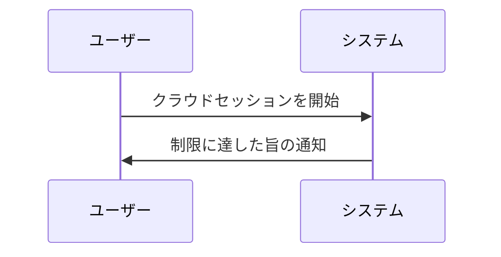

# Claude Code v2.1.302 アップデートまとめ

> 出典: https://code.claude.com/docs/en/changelog#2-1-302

## 💡 注目ポイント

### 1. クライアント側自動モードのモデル選択が可能に

`CLAUDE_CODE_AUTO_MODE_MODEL` 環境変数を追加し、クライアント側の自動モード分類器で使用するモデルを選択できるようになりました。サーバー側の自動モードのモデルは変更されません。

### 2. `/config` に `Idle compaction` 行を追加

`/config` に `Idle compaction` 行を追加し、アイドル時の圧縮をオンまたはオフにできるようになりました。アイドル圧縮後に表示される通知には、オフにする方法が記載されています。

### 3. クラウドセッションの制限に達した際の理由表示

クラウドセッションのルーチンページに、最後の実行が開始されなかった理由（組織がクラウドセッションの同時実行上限に達したなど）を示すバナーを追加しました。

### 4. サブエージェントのデフォルト設定変更

`claude -p`、Agent SDK、デスクトップアプリ、VS Code で、フォークサブエージェント (`subagent_type: "fork"`) がデフォルトでオンになりました。`CLAUDE_CODE_FORK_SUBAGENT=0` でオフにできます。

### 5. エージェントフッターヒントの変更

セッション開始後10秒で `← for agents` フッターヒントが非表示になりますが、待機中のエージェントの数は引き続き表示されます。

## 📋 変更一覧

### ✨ 新機能

| 変更 | 誰にどう嬉しいか |
|---|---|
| `CLAUDE_CODE_AUTO_MODE_MODEL` 環境変数追加 | クライアント側自動モードのモデルを選択できる |
| `/config` に `Idle compaction` 行追加 | アイドル時の圧縮をオン/オフできる |
| クラウドセッション制限理由の表示 | 制限に達した理由がわかる |
| フォークサブエージェントのデフォルトオン | サブエージェントの利用が簡単になる |
| エージェントフッターヒントの変更 | セッション開始後すぐに非表示になる |

### ⬆️ 改善

| 変更 | 誰にどう嬉しいか |
|---|---|
| `/design-sync` と `/design-login` に通知追加 | スタンドアロンの Claude Design 終了日がわかる |
| `claude -p` と Agent SDK セッションのデフォルトモード変更 | デフォルトモードで開始できる |
| メイン会話のサブエージェントが常にバックグラウンドで実行 | サブエージェントの利用が簡単になる |
| プロンプトとエージェントフックの最大実行数を12に制限 | フックの処理が安定する |

### 🐛 バグ修正

| 変更 | 誰にどう嬉しいか |
|---|---|
| `/feedback` ポリシーオフ時のメッセージ変更 | GitHub issues に誘導される |

### 📝 その他

| 変更 | 誰にどう嬉しいか |
|---|---|
| Claude Tag の管理設定を4タブに整理 | 管理がしやすくなる |
| 組織設定のRolesページを変更 | 役割が整理される |
